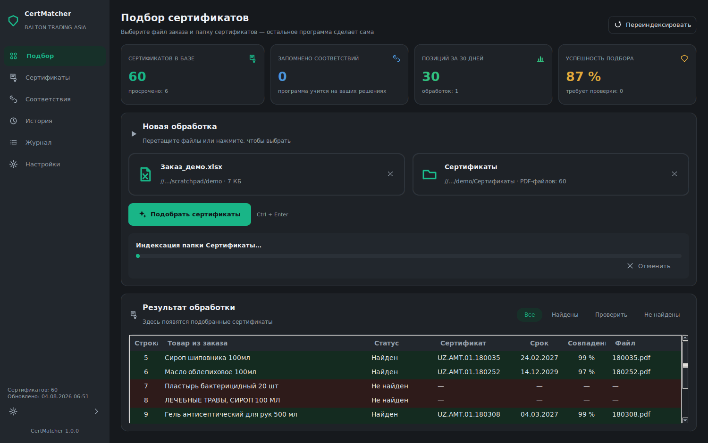
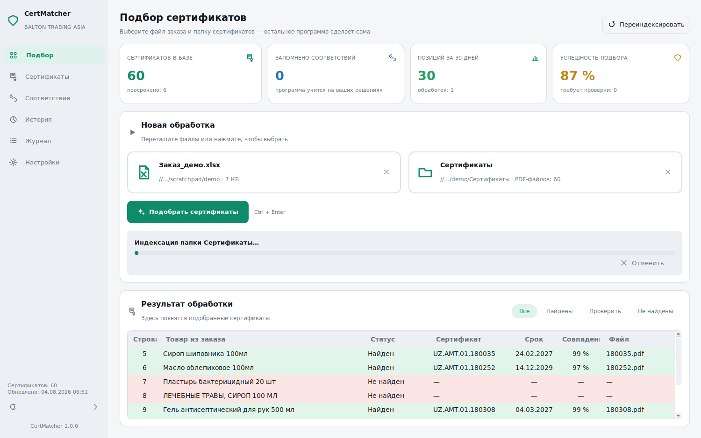
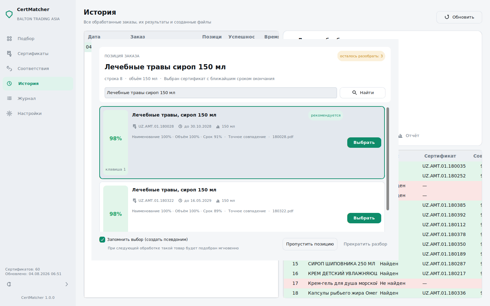
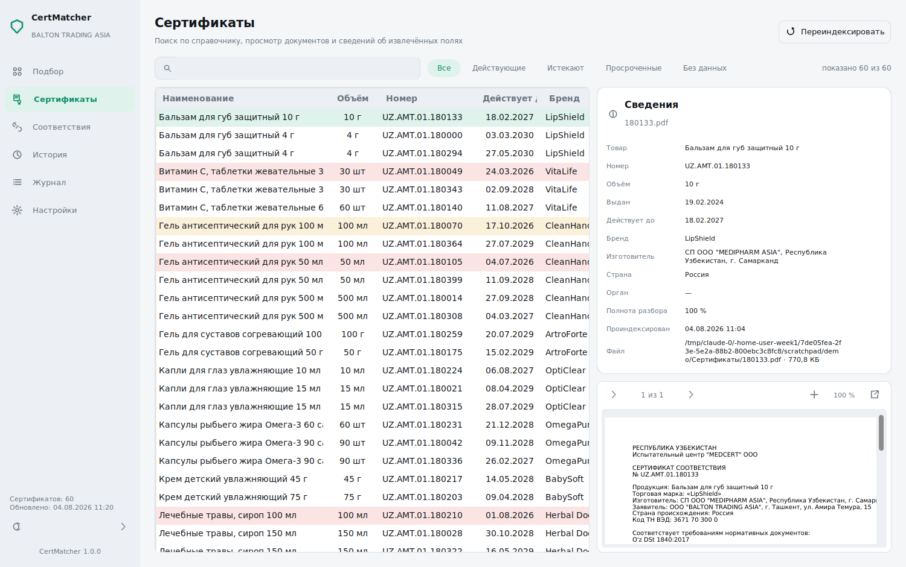
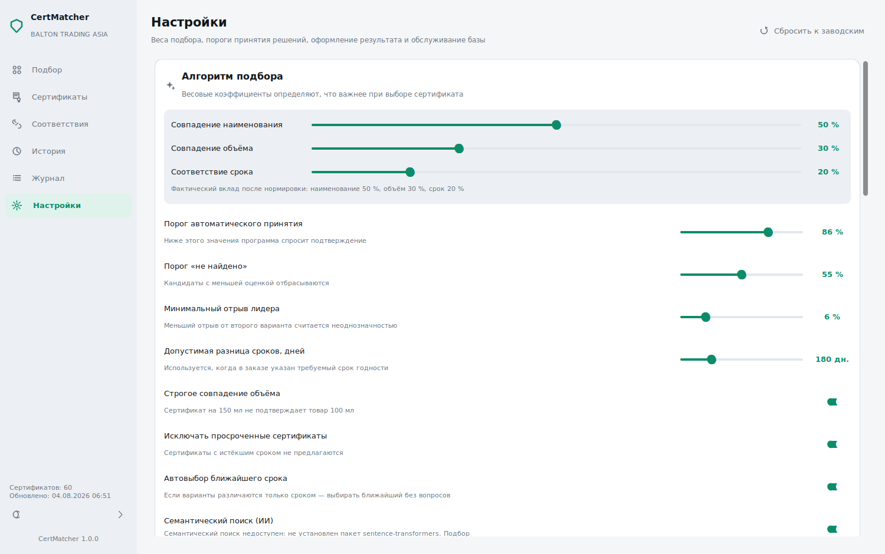
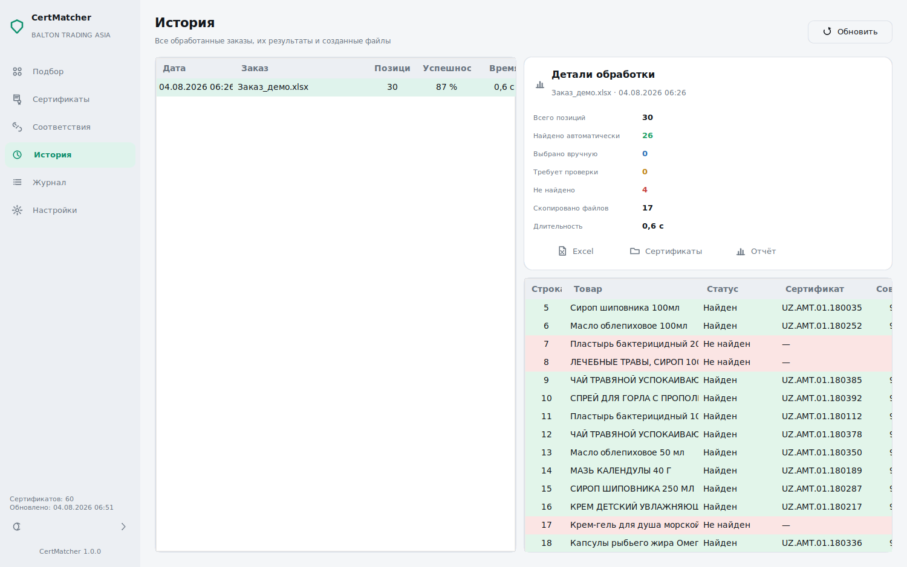

# BALTON CertMatcher

**Автоматический подбор сертификатов соответствия для аптечных заказов BALTON TRADING ASIA.**

Ручная сверка заказа со справочником сертификатов занимает у оператора 20–40 минут.
CertMatcher сокращает это время до нескольких секунд: выберите Excel-файл заказа,
нажмите «Подобрать сертификаты» — остальное приложение сделает само.



---

## Содержание

- [Что делает приложение](#что-делает-приложение)
- [Скриншоты](#скриншоты)
- [Технологии](#технологии)
- [Архитектура](#архитектура)
- [Установка и запуск](#установка-и-запуск)
- [Консольный режим](#консольный-режим)
- [Сборка EXE для Windows](#сборка-exe-для-windows)
- [Конфигурация](#конфигурация)
- [Подбор срока годности](#подбор-срока-годности)
- [Алгоритм подбора](#алгоритм-подбора)
- [Словарь товаров](#словарь-товаров)
- [Разработка](#разработка)
- [Структура проекта](#структура-проекта)

---

## Что делает приложение

1. **Импортирует Excel-базу сертификатов.** Единственный источник данных о
   сертификатах — таблица, которую ведёт пользователь: порядковый номер,
   наименование товара, срок годности, номер сертификата. При выборе файла
   (и при каждом последующем изменении) программа целиком переимпортирует его
   в SQLite — это быстрый индекс над Excel, а не самостоятельное хранилище.
   PDF-файлы сертификатов в подборе не читаются и не разбираются вообще: они
   находятся по номеру сертификата в имени файла и копируются в результат уже
   после того, как подходящая строка базы найдена.
2. **Подбирает срок годности по остаткам (необязательный этап).** Если
   настроена отдельная Excel-таблица остатков (название товара, срок
   годности, количество — обычно несколько партий на один товар), то для
   строк заказа без указанного требуемого срока программа сама определяет
   наиболее подходящую партию ДО поиска сертификата: перебирает партии от
   самой новой к самой старой, проверяет, хватает ли количества, и пробует
   найти сертификат именно на эту дату; первая партия, прошедшая обе
   проверки, и определяет требуемый срок. Если ни одна партия не покрывает
   заказ самостоятельно, программа объединяет несколько партий сразу —
   но только те, для которых уже подтверждён сертификат: физический остаток
   партии без сертификата в расчёт не идёт, даже если он значительно больше
   недостающего количества (подробности — в разделе
   [«Подбор срока годности»](#подбор-срока-годности)). Этот этап не меняет и
   не заменяет подбор сертификата (см. следующий пункт) — он только заранее
   решает, какой срок годности (или сроки) этому подбору передать. Без
   настроенной таблицы остатков поведение не отличается от того, что было до
   появления этой функции.
3. **Подбирает сертификат для каждой строки заказа.** Если наименование заказа
   уже есть в словаре соответствий, весь остальной подбор (RapidFuzz, Sentence
   Transformers, взвешенная оценка) не выполняется — по наименованию и объёму
   из записи словаря выполняется строгий SQL-поиск в базе сертификатов, а из
   найденных строк выбирается ближайшая по сроку годности. Для строк без
   готового соответствия работает пятиэтапный конвейер: точное совпадение →
   нечёткий поиск (RapidFuzz) → семантический поиск (Sentence Transformers,
   опционально) → сравнение объёма и срока годности. При нескольких близких
   вариантах товара с разными сроками автоматически выбирается сертификат с
   ближайшим сроком окончания (FEFO).
4. **Формирует результат:** копию Excel-заказа с добавленными колонками «Сертификат»,
   «С.Г. сертификата» и «Распределение количества» (при желании — с цветовой
   подсветкой строк), папку `Certificates` со всеми найденными PDF (один файл
   копируется один раз, даже если подходит нескольким позициям заказа), отчёт
   о совпадениях и подробный журнал обработки. Ни одна колонка исходного
   заказа — включая требуемый срок годности — никогда не изменяется программой
   без основания: единственное исключение — пустая колонка требуемого срока
   для строк, которым его подобрал предыдущий пункт ОДНОЙ партией, куда
   попадает именно подобранное значение (для заказов, выполненных сразу
   несколькими партиями, единого срока нет — вместо этого заполняются колонки
   «Сертификат»/«С.Г. сертификата»/«Распределение количества», каждая строкой
   на партию). Товары, которых вообще нет в таблице остатков, либо для которых
   не подтверждён ни один сертификат, дополнительно выделяются жёлтым цветом и
   зачёркнутым текстом — для них подбор сертификата не выполнялся вовсе.
5. **Учится на исправлениях.** Если предложенный вариант неверен, пользователь
   выбирает нужный товар в окне неоднозначного выбора — соответствие
   запоминается навсегда и в следующий раз применяется мгновенно, ещё до обращения
   к алгоритмам поиска. Всей накопленной памятью можно управлять напрямую в разделе
   [«Словарь товаров»](#словарь-товаров) — искать, редактировать, объединять,
   импортировать и экспортировать, не трогая базу данных вручную.

## Скриншоты

| Подбор сертификатов | Окно неоднозначного выбора |
|---|---|
|  |  |

| Справочник сертификатов с просмотром PDF | Настройки алгоритма |
|---|---|
|  |  |

| История обработки |
|---|
|  |

## Технологии

| Назначение | Библиотека |
|---|---|
| Язык / версия | Python 3.11+ (целевая среда — 3.13) |
| Интерфейс | CustomTkinter, Pillow (программные векторные иконки) |
| Хранилище | SQLite (WAL) — быстрый индекс над Excel-базой сертификатов |
| Таблицы Excel | pandas, openpyxl |
| Просмотр PDF | PyMuPDF (fitz) — только отрисовка страниц, без чтения содержимого |
| Нечёткий поиск | RapidFuzz |
| Семантический поиск | Sentence Transformers *(опционально)* |
| Числовые вычисления | NumPy |
| Даты | python-dateutil |
| Многопоточность | `concurrent.futures.ThreadPoolExecutor` |
| Сборка | PyInstaller |
| Качество кода | Ruff, Black, MyPy (strict), pytest |

## Архитектура

Приложение построено по слоям Clean Architecture с однонаправленной зависимостью
внутрь (GUI и парсеры зависят от сервисов и моделей; модели ни от чего не зависят):

```
app/
├── core/          # константы, ошибки, пути, текст/даты/объёмы, DI-контейнер
├── config/        # dataclass-настройки + их персистентное хранение
├── database/       # соединение SQLite, схема, миграции
├── models/         # доменные dataclass-модели (CertificateProduct, OrderRow, MatchResult…)
├── repositories/   # весь SQL — единственное место, где он есть (Repository Pattern)
├── parsers/        # разбор Excel-заказов и отрисовка PDF (без чтения содержимого)
├── ai/             # нечёткий и семантический поиск, взвешенная оценка кандидатов
├── services/       # бизнес-сценарии (импорт базы, подбор, экспорт, самообучение)
├── gui/            # CustomTkinter: окно, разделы, переиспользуемые виджеты
└── resources/      # встраиваемые в сборку ресурсы
tests/               # pytest, зеркалирует структуру app/
scripts/              # генератор демо-данных, генератор значка приложения
packaging/            # .spec-файл и метаданные версии для PyInstaller
```

Зависимости собираются в одном месте — `app/core/container.py`
(`ApplicationContainer`) — и создаются лениво: тяжёлые объекты (соединение с
базой, модель эмбеддингов) появляются только при первом обращении, поэтому окно
приложения показывается мгновенно. Слой `gui` не содержит бизнес-логики: он
обращается к сервисам через контейнер и ничего не знает об SQL.

Excel — единственный источник данных о сертификатах, SQLite — только его
индекс: при каждом импорте таблица `certificate_products` переписывается
целиком (`CertificateProductRepository.replace_all`), что для файла в тысячи
строк занимает миллисекунды и не требует более сложной логики. PDF-файлы в
этой схеме — не источник данных, а вложения: `CertificateFileIndex`
(`app/services/certificate_file_locator.py`) находит нужный файл по номеру
сертификата в имени и копирует его как есть — их содержимое нигде не
читается и не разбирается.

## Установка и запуск

Требуется Python 3.11 или новее.

```bash
python -m venv .venv
source .venv/bin/activate   # Windows: .venv\Scripts\activate

pip install -e .
python -m app.main
```

Семантический поиск (третий этап конвейера подбора) — необязательная зависимость:
без неё приложение полностью работоспособно на псевдонимах и нечётком поиске.

```bash
pip install -e ".[ai]"      # добавляет sentence-transformers
```

Перетаскивание файлов (drag&drop) в окно работает через отдельный пакет:

```bash
pip install -e ".[dnd]"
```

### Демонстрационные данные

Чтобы оценить приложение без реальных документов, сгенерируйте синтетический
набор — сертификаты и заказ, покрывающий все ветви алгоритма (точные совпадения,
разные фасовки, неизвестные позиции):

```bash
python scripts/generate_demo_data.py --output demo --certificates 120 --rows 40
```

## Консольный режим

Тот же EXE обслуживает и пакетную обработку — например, по расписанию через
Планировщик заданий Windows, без открытия окна:

```bash
certmatcher import "D:\Сертификаты\База.xlsx"                    # импорт базы сертификатов
certmatcher import-expiry "D:\Остатки\Сроки.xlsx"                # импорт базы сроков годности
certmatcher process "D:\Заказы\Заказ.xlsx" -o "D:\Результат" ^
    --certificates "D:\Сертификаты\База.xlsx" ^
    --expiry-stock "D:\Остатки\Сроки.xlsx"
certmatcher search "Лечебные травы 100 мл"                       # поиск по базе сертификатов
certmatcher stats                                                # статистика баз
certmatcher selfcheck                                            # проверка установки
```

## Сборка EXE для Windows

Сборка выполняется на Windows (PyInstaller не кросс-компилирует):

```powershell
pip install -e ".[dev]"
python scripts\build_icon.py
pyinstaller packaging\certmatcher.spec --noconfirm
```

Готовый файл — `dist\BaltonCertMatcher.exe`: один исполняемый файл, без
установки Python на целевой машине. EXE собирается в оконном режиме (без
мигающей консоли при двойном клике); те же консольные команды продолжают
работать при запуске из PowerShell — EXE сам подключается к консоли
родительского процесса.

По умолчанию сборка **не включает** `sentence-transformers`/`torch` — они
весят более гигабайта, а приложение полноценно работает без них (третий этап
подбора просто не активируется). Чтобы собрать вариант с семантическим
поиском, установите `pip install -e ".[ai]"` в окружении сборки и уберите
соответствующие пакеты из `AI_EXCLUDES` в `packaging/certmatcher.spec`.

## Конфигурация

Все параметры вынесены из кода и редактируются в разделе «Настройки» приложения
(сохраняются в `config/settings.json` рядом с данными):

- **Веса подбора** — совпадение наименования / объёма / срока (по умолчанию 50/30/20 %).
- **Пороги решений** — с какой оценки принимать автоматически, с какой считать
  совпадение отсутствующим, какой отрыв лидера считать неоднозначностью.
- **Допуск по сроку годности** — на сколько дней требуемый и фактический срок
  может расходиться (в любую сторону, год учитывается). Это жёсткая граница,
  а не мягкое снижение оценки: сертификат за её пределами не становится
  кандидатом вообще, ни при взвешенном подборе, ни при подборе по словарю
  (там всегда выбирается ближайший по сроку — но строго среди уложившихся в
  допуск), ни при автоматическом подборе/объединении партий срока годности.
  Единственное место, где сертификат за пределами допуска всё же можно
  использовать, — ручное подтверждение конкретного варианта пользователем
  (Этап 3 подбора срока годности, см. ниже); автоматически он не выбирается
  никогда.
- **Строгость сравнения объёма**, исключение просроченных сертификатов,
  автоматический выбор ближайшего срока при равных вариантах.
- **База сертификатов** — путь к Excel-файлу (единственный источник данных),
  папка с PDF (только для копирования по номеру сертификата в имени файла).
- **База сроков годности и остатков** — путь к отдельному Excel-файлу (название
  товара, срок годности, количество); пусто — этап автоматического подбора
  срока годности не активен, поведение как без этой функции. Здесь же —
  сколько ближайших вариантов предлагать на партию в окне ручного
  подтверждения (по умолчанию 3), когда строгий подбор не находит сертификат
  ни для одной партии товара.
- **Оформление результата** — цвета подсветки строк, названия колонок, формат
  отчёта, копирование PDF, цвет строк с товаром вне базы сроков годности.
- **Обслуживание** — автоматические резервные копии базы, их количество,
  уровень журналирования.

Портативный режим (данные рядом с EXE) включается автоматически, если каталог
программы доступен на запись, либо файлом-маркером `portable.flag`; иначе данные
размещаются в `%LOCALAPPDATA%\BaltonCertMatcher`.

## Подбор срока годности

Отдельный, полностью самостоятельный этап, выполняемый ДО начала подбора
сертификата (см. предыдущий раздел). Источник данных — отдельная от базы
сертификатов Excel-таблица остатков: одна строка — одна партия товара, один
товар может встречаться много раз с разными сроками и количествами. Этап
не изменяет и не заменяет алгоритм подбора сертификата — он лишь пробными
вызовами того же самого, ничем не изменённого подбора решает, для какой
партии (или партий) сертификат точно найдётся, и передаёт дальше только их.

Правило первым делом всегда простое: если заказ может закрыть одна партия —
используется она одна, без объединения с другими. Когда ни одна партия не
справляется в одиночку, в дело идёт вторая часть алгоритма — объединение
нескольких партий сразу. А если сертификат не подтверждён **вообще ни для
одной** партии товара — прежде чем сдаться, третья часть предлагает
пользователю ближайшие по сроку варианты на ручное подтверждение (см. ниже).

```
Строка заказа (требуемый срок ещё не указан)
      │
      ▼
Товар есть в базе остатков?
      │ нет                                       │ да
      ▼                                            ▼
Жёлтая заливка + зачёркнутый текст,     Партии сортируются от новой к старой;
«Товар отсутствует в базе сроков»       для КАЖДОЙ партии пробным подбором
                                         проверяется сертификат — доступное
                                         количество партии равно остатку,
                                         если сертификат подтверждён, и
                                         нулю, если нет (даже если остаток
                                         физически большой)
                                                    │
                                                    ▼
                              Партия одна покрывает заказ (доступного
                              количества хватает)?
                              │  да → эта партия используется одна, её
                              │       срок становится требуемым сроком
                              │       строки, дальше — обычный подбор
                              │       сертификата (не изменён)
                              │  нет ↓
                              Ни у одной партии сертификата вообще нет?
                              │  да → ЭТАП 3 (ручной режим, см. ниже):
                              │       есть варианты для предложения?
                              │       да  → окно подтверждения, ждём
                              │             пользователя
                              │       нет → жёлтая заливка + зачёркнутый
                              │             текст, «Для доступных сроков
                              │             не найден подходящий сертификат»
                              │  нет ↓
                              Суммарное доступное количество (только
                              партии с сертификатом!) достаточно?
                              │  нет → «не найдено», обычная подсветка,
                              │        «Недостаточно остатка по партиям
                              │        с подходящими сертификатами»
                              │  да ↓
                              Жадное распределение от новой партии к
                              старой: взять максимум возможного из
                              каждой, пока не наберётся нужное
                              количество — колонки E/F/G заполняются
                              построчно, по одной строке на партию
```

Критический пример (дословно из требования): нужно 1500 шт., партия
25.05.2028 даёт 1068 шт. и сертификат для неё найден, ещё две партии
физически содержат 880 и 700 шт., но сертификата ни для одной из них нет.
Доступное количество — только 1068 (а не 1068+880+700), заказ выполнить
нельзя, хотя физический остаток на складе в разы больше требуемого —
партии без подтверждённого сертификата в расчёт не идут никогда.

Строки, у которых требуемый срок годности уже указан в самом заказе, через
этот этап вообще не проходят — их значение является осознанным решением
человека и не подлежит проверке или замене.

### Этап 3 — ручное подтверждение вне допуска

Если после проверки всех партий сертификат не подтверждён ни для одной из
них, приложение не сдаётся сразу: для каждой такой партии оно ищет
сертификаты того же товара и объёма, но **без учёта допуска по сроку**
(`expiry_tolerance_days`), сортирует их по расхождению в днях и показывает
пользователю несколько ближайших (по умолчанию 3, настраивается) в
отдельном окне — по разделу на партию, с кнопкой «Выбрать» у каждого
варианта. В интерфейсе расхождение отмечено цветом (🟢 в пределах допуска,
🟡 больше допуска, 🔴 значительно больше) — это только подсказка, на выбор
и на бизнес-логику она не влияет.

Ничего из показанного не используется автоматически. Только после того как
пользователь нажимает «Выбрать» для конкретного варианта и завершает разбор
строки кнопкой «Готово», эта партия становится «имеющей сертификат» и
участвует в распределении количества — точно по тем же правилам, что и
партии, подтверждённые автоматически (включая объединение нескольких
партий, если одной подтверждённой не хватает). Подтверждённый вручную
сертификат помечается статусом «Выбран вручную» и попадает в итоговый Excel
так же, как обычный найденный сертификат. Строгий автоматический алгоритм
(допуск ±`expiry_tolerance_days`, объединение партий) при этом остаётся
полностью без изменений — ручной режим включается только когда он уже
исчерпан.

Подтверждение сертификата в этом окне — разовое решение для конкретной
партии заказа. Оно **никогда** не создаёт и не изменяет запись в словаре
товаров: это не «научить программу», а «использовать этот сертификат сейчас».
Если пользователь ничего не подтвердил (закрыл окно, нажал «Пропустить
позицию» или «Прекратить разбор») — строка получает то же исключение «нет
подходящего сертификата», что и без этого этапа вообще.

## Алгоритм подбора

```
Строка заказа
      │
      ▼
1. Псевдонимы — абсолютный источник истины, не канал оценки.
   Найдено? → строгий SQL-поиск в базе сертификатов по
   (normalized_name, volume_ml) записи словаря → отбросить
   строки за пределами допуска по сроку (если он требуется) →
   выбрать ближайшую по сроку среди оставшихся → готово. Официальный
   товар из словаря пропал из базы (Excel изменился) — или ни одна
   его строка не уложилась в допуск по сроку — единственное
   исключение: одна повторная попытка через обычный конвейер
   (шаги 2–4 ниже) по тексту заказа, результат помечается для
   подтверждения и обновления словаря. Не нашёл и он — строка
   «не найдена».
      │ записи в словаре нет
      ▼
2. Точное совпадение нормализованного наименования
      │
      ▼
3. Нечёткий поиск (RapidFuzz, сравнение по сигнатуре без чисел/единиц —
   защита от ложных совпадений вида «Крем 100 мл» ≈ «Гель 100 мл»)
      │
      ▼
4. Семантический поиск (Sentence Transformers) — подключается только когда
   лексика неуверена; находит совпадения без общих букв («TP Herbal» = «Лечебные травы»)
      │
      ▼
5. Сравнение объёма (безусловная отбраковка при несовпадении, если включён
   строгий режим) и срока действия (безусловная отбраковка при просрочке, а
   если в заказе указан требуемый срок — и при расхождении сверх допуска)
      │
      ▼
6. Из нескольких равных по названию и объёму кандидатов — ближайший по сроку (FEFO)
      │
      ▼
Итоговая взвешенная оценка → автоматически принято / показать пользователю / не найдено
```

Наименования сравниваются в двух формах — нормализованной и латинизированной
(практическая транслитерация), что позволяет сопоставлять кириллицу и латиницу
без обращения к нейросетевой модели. Каждое ручное исправление сохраняется в
таблицу `aliases` и применяется раньше любых алгоритмов при следующей обработке.
Ни один из этапов не читает PDF: подбор целиком построен на Excel-базе
сертификатов, проиндексированной в SQLite.

## Словарь товаров

Раздел «Словарь товаров» — полноценный редактор накопленной «памяти» приложения,
а не просто список для просмотра:

- **Поиск и фильтры.** Мгновенный поиск сразу по системному наименованию, товару
  в базе сертификатов, бренду и комментарию (без учёта регистра — в том числе для
  кириллицы), фильтры по бренду и объёму, сортировка по дате изменения, дате
  создания, числу применений, названию или уровню доверия.
- **Добавление и редактирование.** Пользователь вводит только системное
  название товара целиком, как оно приходит в заказе (например,
  «61004628 TP Dr Rabbit Kids Bubblegum 50ml [48]») — код товара, тип, само
  название, объём и количество в коробке распознаются автоматически и
  показываются рядом, вводить их вручную не нужно. Справа — подбор товара из
  базы сертификатов в двух режимах одновременно: сверху ИИ-предложения
  (RapidFuzz + Sentence Transformers, с учётом транслитерации и объёма, тот
  же алгоритм, что и при обработке заказа) со звёздным рейтингом совпадения,
  снизу — мгновенный ручной поиск по названию, части слова или объёму как
  резерв для сложных случаев. Целью соответствия всегда становится
  конкретная выбранная позиция базы, а не свободный текст; при сохранении
  запоминается и её идентификатор (как необязательная подсказка — если база
  переимпортируется, подсказка сама сбрасывается, а подбор всё равно
  продолжает искать заново по названию и объёму, поэтому не устаревает).
  Перед сохранением словарь проверяется на похожие записи (нечёткое
  сравнение), и при совпадении программа спрашивает подтверждение —
  случайные почти-дубликаты не накапливаются молча.
- **Уровень доверия.** Каждая запись имеет доверие 100% (создана пользователем
  вручную), 95% (создана автоматически и с тех пор многократно подтверждена
  применением) или 80% (создана автоматически, ещё не подтверждена). Поиск по
  словарю и подбор сертификатов всегда предпочитают запись с более высоким
  доверием.
- **Массовые операции.** Выделение нескольких записей (Shift/Ctrl + клик) —
  массовое удаление или массовое присвоение бренда.
- **Журнал изменений и отмена.** Каждое создание, изменение и удаление
  фиксируется в журнале с датой, автором и снимком «было/стало»; кнопка
  «Отменить» (Ctrl+Z) последовательно отматывает историю на один шаг назад.
- **Резервное копирование.** Независимо от общей резервной копии базы — снимок
  словаря в отдельный файл и восстановление из него (импорт со слиянием, без
  потери текущих записей).
- **Импорт/экспорт** в Excel, CSV и JSON; при импорте совпадающие по
  наименованию и сертификату записи объединяются, а не дублируются.
- **Горячие клавиши:** `Ctrl+N` — добавить, `Ctrl+E` — изменить выбранную
  запись, `Delete` — удалить, `Ctrl+Z` — отменить последнее действие.

## Разработка

```bash
pip install -e ".[dev]"

pytest                                   # 374 теста, < 10 секунд
ruff check app tests scripts
black --check app tests scripts
mypy app
```

Все четыре команды проходят без замечаний на текущей кодовой базе — это
поддерживаемый инвариант, а не разовое состояние.

### Тесты

Тесты зеркалируют структуру `app/` и разделены по уровням: чистые функции ядра
(`tests/core`) не требуют СУБД или графики; репозитории (`tests/repositories`)
поднимают временную SQLite-базу на каждый тест; `tests/services` включает
сквозные интеграционные тесты полного сценария «выбрать Excel → нажать кнопку →
получить результат» через реальный `OrderProcessingService`.

## Структура проекта

```
app/
├── core/            constants.py, exceptions.py, paths.py, text.py, units.py,
│                    dates.py, product_code.py, logging_setup.py, events.py,
│                    concurrency.py, container.py
├── config/          settings.py — dataclass-конфигурация всех подсистем
├── database/        connection.py, schema.py
├── models/          certificate_product.py, expiry_stock.py, order.py, alias.py, product.py,
│                    history.py, matching.py
├── repositories/    certificate_product_, expiry_stock_, alias_, product_, history_, cache_,
│                    settings_repository.py
├── parsers/         excel_order_parser.py, column_mapper.py, pdf_parser.py (только отрисовка страниц)
├── ai/              fuzzy.py, embeddings.py, vector_index.py, scorer.py
├── services/        certificate_import_, expiry_import_, expiry_resolution_, matching_,
│                    order_processing_, excel_writer_, certificate_copy_,
│                    certificate_file_locator.py, report_, alias_, backup_service.py
├── gui/
│   ├── app.py               главное окно
│   ├── theme.py             дизайн-система (палитры, типографика, отступы)
│   ├── icons.py             векторные иконки, отрисовываемые программно
│   ├── animations.py        плавные переходы
│   ├── views/                разделы: dashboard, certificates, aliases, history, logs, settings
│   └── widgets/               card, data_table, drop_zone, ambiguity_dialog, pdf_viewer, toast…
├── cli.py           консольный режим
└── main.py          точка входа (GUI/CLI диспетчеризация)
tests/                зеркалирует структуру app/
scripts/              generate_demo_data.py, build_icon.py
packaging/             certmatcher.spec, version_info.txt
```

---

*BALTON CertMatcher разработан для ежедневной эксплуатации в BALTON TRADING ASIA.*
